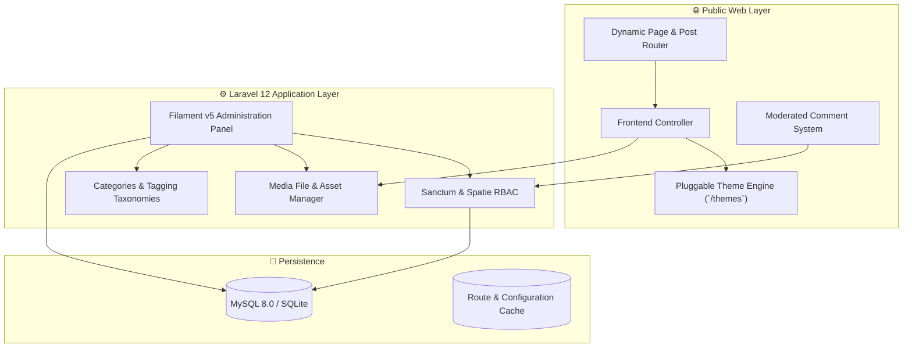

# Sairox — Modern Extensible Headless & Themed CMS Engine

[](https://laravel.com)
[](https://filamentphp.com)
[](https://www.php.net)
[]()
[](https://tailwindcss.com)
[]()

**Sairox** is a high-performance, modular **Content Management System (CMS)** built on **Laravel 12**, **Filament v5**, and **PHP 8.3+**. Engineered with an isolated **Theme Engine**, real-time draft/preview capabilities, dynamic menu & widget managers, media library asset indexing, and fine-grained role-based access control (RBAC).

---

## 🏛️ System Architecture



---

## 🌟 Core System Features

### 1. 🎨 Pluggable Theme Engine
- **Decoupled Themes:** Complete template isolation inside the `/themes` directory (e.g. `sairox-default`).
- **Dynamic Asset Injection:** Each theme controls its own CSS, JavaScript, and Blade layouts without touching the core application kernel.
- **Theme Switcher:** Allows switching or overriding front-end presentations on the fly.

### 2. ⚡ Filament v5 Administrative Suite
- **Rich Content Publishing:** Live draft previewing (`/preview/posts/{slug}`), scheduled releases, and SEO slug auto-generation.
- **Taxonomy Management:** Hierarchical categories and many-to-many tag relationships.
- **Dynamic Menu & Navigation Builder:** Drag-and-drop hierarchy navigation tree with nested items.
- **Widget System:** Modular widget positioning across sidebar, header, and footer layout regions.

### 3. 🖼️ Enterprise Media Library
- **Centralized Asset Indexing:** Upload, tag, optimize, and organize media across albums.
- **Automatic Thumbnail Generation:** Responsive picture source sets for mobile, tablet, and desktop display.

### 4. 🔐 Fine-Grained Role & Permission Governance
- Powered by `spatie/laravel-permission`:
  - **Super Administrator:** Unrestricted control over plugins, users, database, and themes.
  - **Editor:** Full publication authority over articles, media, and comments.
  - **Author / Contributor:** Scoped authoring with editorial review workflows before publishing.

### 5. 💬 Moderated Discussion Engine
- Threaded user comments with spam detection, approval queues, and notification webhooks.

---

## 🛠️ Technology Stack

| Layer | Technologies |
|---|---|
| **Core Framework** | Laravel 12.x, PHP 8.3+ |
| **Admin Panel** | Filament v5 (TALL Stack: Tailwind, Alpine.js, Laravel, Livewire) |
| **Authentication & RBAC** | Laravel Sanctum, Spatie Laravel-Permission |
| **Asset Bundling** | Vite, Tailwind CSS v4 |
| **Database** | MySQL 8.0 / SQLite |
| **Testing & Quality** | PHPUnit 12, Laravel Pint, Pest PHP |

---

## 📂 Domain Directory Layout

```
sairox/
├── app/
│   ├── Filament/
│   │   ├── Pages/                     # Custom admin dashboards
│   │   └── Resources/                 # CRUD engines
│   │       ├── Categories/            # Category taxonomy
│   │       ├── Comments/              # Discussion moderation
│   │       ├── MediaFiles/            # Asset library
│   │       ├── Menus/                 # Navigation tree builder
│   │       ├── Pages/                 # Static & custom landing pages
│   │       ├── Permissions/           # Granular capability definitions
│   │       ├── Posts/                 # Rich article publisher
│   │       ├── Roles/                 # Spatie RBAC matrix
│   │       ├── Tags/                  # Content tagging
│   │       └── Widgets/               # Modular frontend blocks
│   └── Http/Controllers/              # Public Frontend & Comment controllers
├── themes/
│   └── sairox-default/                # Isolated presentation layer
│       ├── views/                     # Blade layouts, partials & pages
│       └── assets/                    # Theme-specific CSS/JS
├── routes/
│   ├── web.php                        # SEO slug resolver & frontend routing
│   └── api.php                        # Headless API endpoints
└── composer.json                      # Dependencies
```

---

## ⚙️ Local Development & Quick Start

### Prerequisites
- **PHP:** `>= 8.3` (Extensions: `pdo_mysql`, `mbstring`, `openssl`, `intl`, `fileinfo`)
- **Composer:** `>= 2.5`
- **Node.js & NPM:** `Node 20+` / `NPM 10+`
- **Database:** MySQL 8.0+ or SQLite

### Installation Steps

```bash
# 1. Clone repository
git clone https://github.com/alramim07/sairox.git
cd sairox

# 2. Install PHP and NPM dependencies
composer install
npm install

# 3. Environment configuration
cp .env.example .env
php artisan key:generate

# 4. Database migrations & seed defaults
php artisan migrate --seed

# 5. Create administrative superuser for Filament
php artisan make:filament-user

# 6. Build assets & start server
npm run build
php artisan serve
```

- Public Site: **`http://127.0.0.1:8000`**
- Filament Admin Panel: **`http://127.0.0.1:8000/admin`**

---

## 🧪 Testing & Code Quality

```bash
# Run test suite
php artisan test

# Verify PSR-12 code style with Laravel Pint
./vendor/bin/pint --test
```

---

## 📄 License
This project is open-source software licensed under the [MIT License](LICENSE).
